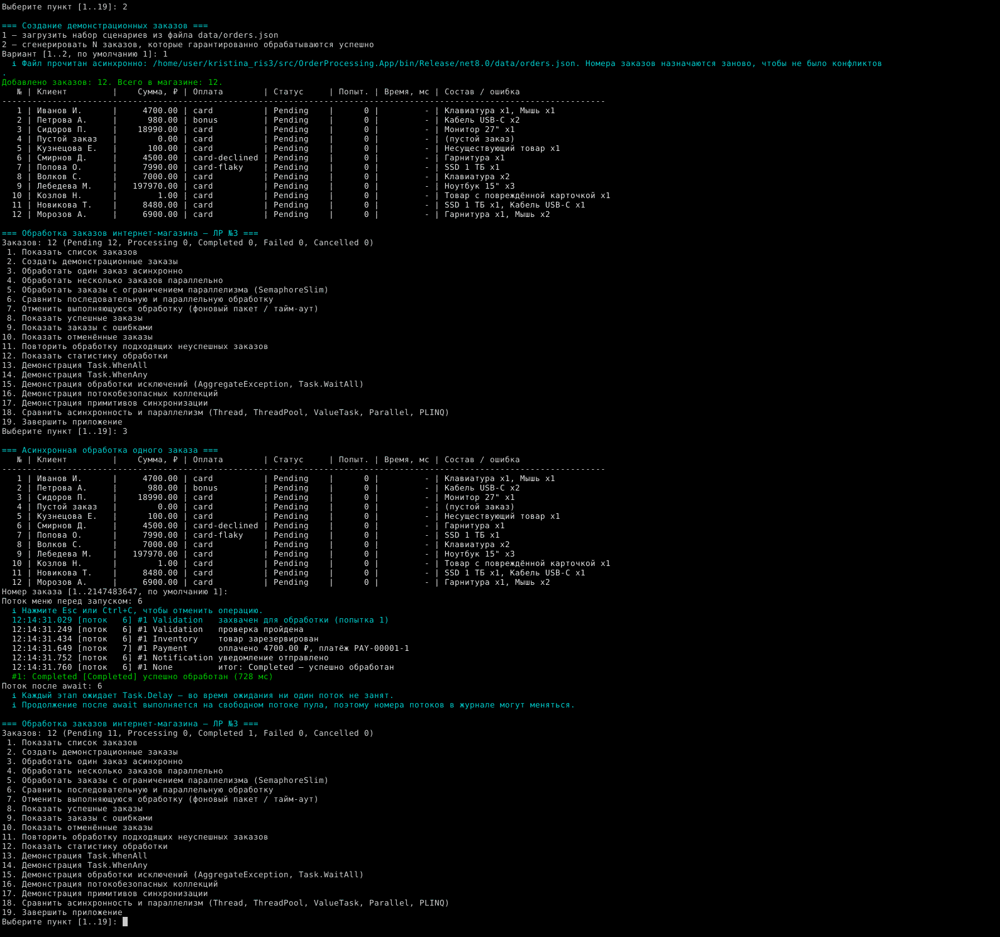
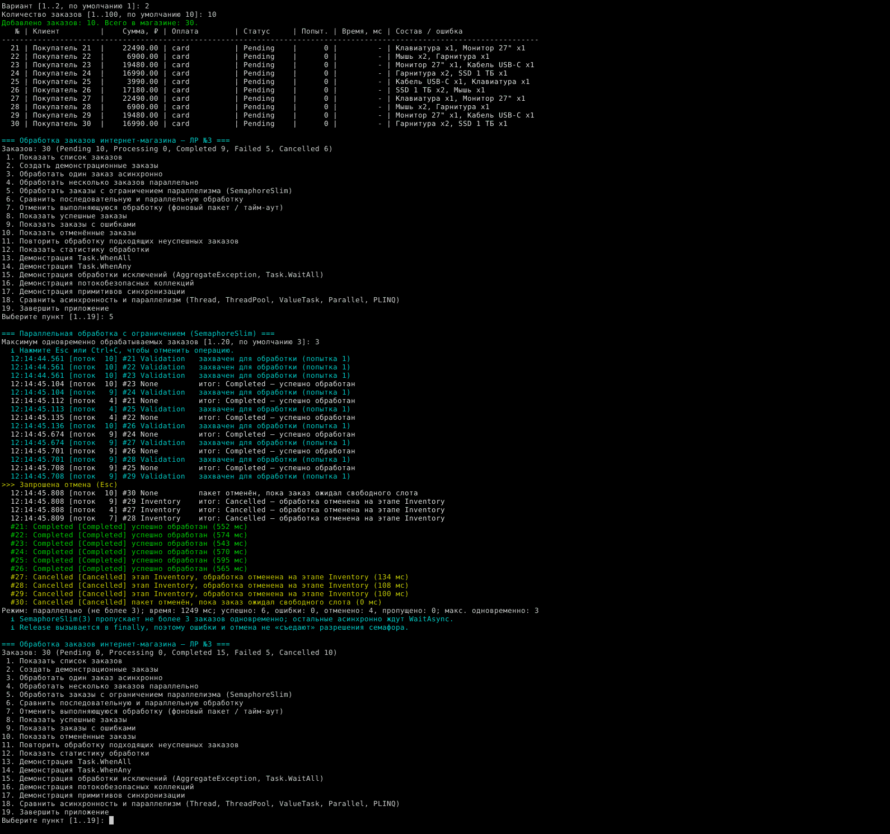
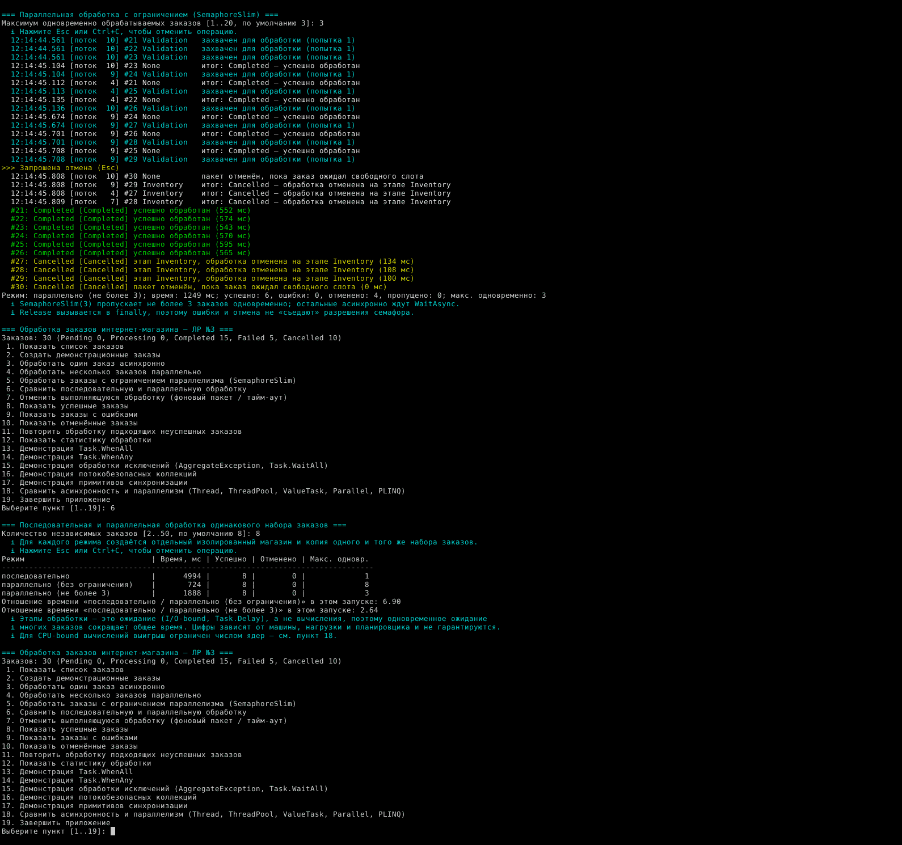
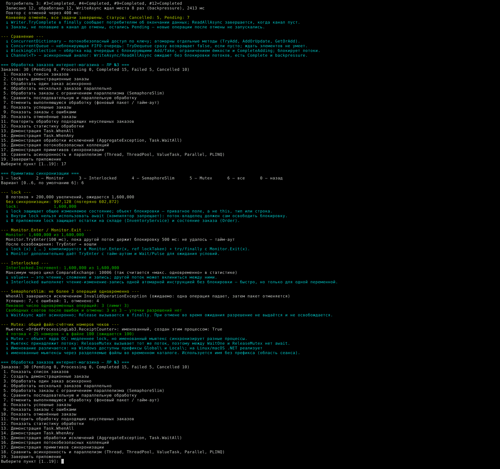

# Отчёт по лабораторной работе № 3

## Титульная страница

| Поле | Значение |
|------|----------|
| Учебное заведение | ____________________________________________ |
| Кафедра | ____________________________________________ |
| Дисциплина | ____________________________________________ |
| Лабораторная работа | № 3 «Асинхронность и многопоточность в C#» |
| Вариант | Параллельная обработка заказов интернет-магазина (эмуляция) |
| Выполнил(а), группа | ____________________________________________ |
| Проверил(а) | ____________________________________________ |
| Дата | ____________________________________________ |

---

## 1. Цель работы

Изучить средства асинхронного и параллельного программирования платформы .NET: потоки и пул
потоков, `Task`/`Task<T>`/`ValueTask`, `async/await`, агрегацию задач, кооперативную отмену,
обработку исключений, примитивы синхронизации и потокобезопасные коллекции, `Parallel.For` и PLINQ.
Применить их в консольном приложении, которое работает автономно, без доступа к интернету.

## 2. Индивидуальный вариант

Параллельная обработка заказов интернет-магазина (эмуляция): заказы проходят этапы проверки,
резервирования на складе, оплаты и уведомления; внешние службы эмулируются.

## 3. Постановка задачи

Разработать консольное приложение (.NET 8, C# 12, Linux и Windows), которое:

- хранит заказы с идентификатором, составом, суммой, статусом, временем создания, начала и
  завершения обработки, сведениями об ошибке или отмене;
- обрабатывает заказ асинхронно через несколько этапов с поддержкой `CancellationToken`;
- обрабатывает пакеты заказов последовательно, параллельно и с ограничением числа одновременных
  операций, не допуская одновременной обработки одного заказа двумя задачами;
- позволяет отменить выполняющуюся обработку, повторить подходящие неуспешные заказы и показывает
  статистику, согласованную с фактическими статусами;
- содержит демонстрации `Task.WhenAll`, `Task.WhenAny`, `Task.WaitAll`, исключений, коллекций,
  примитивов синхронизации, сравнения асинхронности и параллелизма;
- имеет русскоязычное меню, устойчивое к ошибочному вводу;
- покрыто автоматическими тестами и не обращается к сети.

## 4. Предметная модель

| Тип | Назначение |
|-----|------------|
| `Order` | заказ: `Id`, `Customer`, `Email`, `PaymentMethod`, `Items`, `Total`, `CreatedAt`, а также изменяемое состояние — `Status`, `StartedAt`, `FinishedAt`, `ErrorMessage`, `FailedStage`, `IsRetryable`, `Attempts`, `StockReserved`, `PaymentId`, `CustomerNotified` |
| `OrderItem` | неизменяемая позиция заказа (`record`): `Sku`, `Name`, `Quantity`, `UnitPrice`, `Total` |
| `OrderStatus` | `Pending`, `Processing`, `Completed`, `Failed`, `Cancelled` |
| `ProcessingStage` | `Validation`, `Inventory`, `Payment`, `Notification` |
| `OrderStatusTransitions` | таблица допустимых переходов |
| `OrderProcessingException` и наследники | бизнес-ошибки: `OrderValidationException`, `OutOfStockException`, `PaymentException`, `NotificationException`; у каждой есть этап и признак «временная» |
| `OrderProcessingResult` | неизменяемый итог попытки: исход (`Completed/Failed/Cancelled/Skipped`), итоговый статус, этап, сообщение, длительность, номер попытки, исключение |
| `ProcessingStatistics` | атомарные счётчики попыток, пик одновременной обработки, ошибки по этапам |

Допустимые переходы статусов:

```
Pending    ──► Processing      захват заказа рабочей задачей
Pending    ──► Cancelled       пакет отменён до начала обработки заказа
Processing ──► Completed       все этапы пройдены (конечный статус)
Processing ──► Failed          бизнес-ошибка или непредвиденное исключение
Processing ──► Cancelled       отмена во время обработки
Failed     ──► Pending         повтор, только если ошибка временная
Cancelled  ──► Pending         повтор
```

`Completed` не имеет исходящих переходов, поэтому заказ не может быть одновременно успешным и
отменённым. Переход проверяется в `Order.TransitionUnsafe` под приватной блокировкой; недопустимый
переход — это ошибка программы (`InvalidOrderTransitionException`), а не бизнес-ошибка.

## 5. Архитектура приложения

```
OrderProcessing.App (консоль)                  OrderProcessing.Core (библиотека)
 Program ─► MainMenu ─► OrderCommands ─────────► BatchOrderProcessor ─► ConcurrencyLimiter (SemaphoreSlim)
                │                                        │
                └─► Demos/*                              ▼
                     (WhenAll, WhenAny,           OrderProcessor ─► IProductCatalog   (ValueTask, кэш)
                      исключения, коллекции,             │       ─► IInventoryService (lock)
                      синхронизация,                     │       ─► IPaymentService   (Task<T>, Task.FromResult)
                      Thread/Parallel/PLINQ)             │       ─► INotificationService (Task)
                                                         ├─► OrderRepository   (ConcurrentDictionary)
 Infrastructure: Ui, ConsoleProgress,                    ├─► OrderEventJournal (ConcurrentQueue)
 ForegroundCancellation (Esc / Ctrl+C)                   └─► ProcessingStatistics (Interlocked)
```

- **Core** не зависит от консоли и полностью покрыт тестами. Службы описаны интерфейсами, поэтому
  тесты подменяют оплату управляемой заглушкой `ControlledPaymentService`.
- **App** содержит меню (`MainMenu`), команды над заказами основного магазина (`OrderCommands`) и
  демонстрации. Демонстрации и сравнение режимов создают изолированный `ShopEnvironment`, чтобы не
  менять остатки и статистику основного магазина.
- Задержки внешних служб задаёт `SimulationOptions` (по умолчанию 40–260 мс на этап с
  детерминированной добавкой по номеру заказа; в тестах `SimulationOptions.Instant` — нулевые).

## 6. Потоки и `ThreadPool`

Поток (`System.Threading.Thread`) — единица планирования ОС с собственным стеком. Создание потока
требует системного вызова и памяти под стек, поэтому оно дорого. В приложении выделенные потоки
используются там, где они уместны:

- `AsyncParallelDemos.ThreadsAndPoolAsync` — ручной поток `order-report-thread` (`IsBackground = true`),
  выполнение отчёта и ожидание через `Join`;
- `CounterStress.Run` и `MutexDemo` — несколько потоков, стартующих по `ManualResetEventSlim`, все
  дожидаются через `Join`;
- `BlockingCollectionPipeline` — потребители и производитель запускаются как
  `TaskCreationOptions.LongRunning`, потому что `BlockingCollection` блокирует потоки.

`ThreadPool` хранит набор готовых рабочих потоков и переиспользует их. В демонстрации (пункт 18 → 1)
200 рабочих элементов `ThreadPool.QueueUserWorkItem` ожидаются через `CountdownEvent`.

Результат запуска (Linux, 4 ядра, Release):

```
200 новых Thread: 34.8 мс; 200 элементов ThreadPool: 4.5 мс
Элементы пула выполнили 12 разных потоков (потоки переиспользуются)
Пул: потоков сейчас 13, минимум рабочих 4, I/O 1, доступно рабочих 32766; ядер: 4
```

**`Thread` и `Task`.** `Task` — объект, представляющий операцию и её будущий результат, а не поток.
`Task.Run` ставит делегат в очередь пула, и планировщик сам выбирает поток, поэтому `Task` не
гарантирует отдельного физического потока. Задача может и вовсе не занимать поток: в той же
демонстрации 1000 одновременных `Task.Delay(300)` завершились, а число потоков пула осталось 13 —
ожидание реализовано таймером. Поэтому асинхронность не означает создания нового потока.

Все демонстрации завершают свои потоки (`Join`, ожидание `CountdownEvent`, `await` задач), так что
после возврата в меню рабочих потоков не остаётся.

## 7. `Task`, `Task<T>` и `ValueTask`

| Тип | Пример в коде | Комментарий |
|-----|---------------|-------------|
| `Task` | `INotificationService.SendAsync` | операция без результата |
| `Task<T>` | `OrderProcessor.ProcessAsync` → `Task<OrderProcessingResult>`; `IPaymentService.ChargeAsync` → `Task<PaymentReceipt>` | операция с результатом |
| `Task.FromResult` | `PaymentService.ChargeAsync` для оплаты бонусами | результат известен сразу: возвращается завершённая задача без конечного автомата и без обращения к шлюзу |
| `ValueTask<T>` | `IProductCatalog.FindAsync` | при попадании в кэш результат синхронный, без аллокации `Task` |

`ValueTask<T>` выбран только для каталога, потому что обращение к нему повторяется для каждой
позиции каждого заказа и обычно попадает в кэш. В основном прогоне меню (пункт 12) счётчики показали
7 попаданий и 9 обращений к «удалённому» каталогу, в демонстрации 18 → 3 — 3 попадания из 5 вызовов,
каждое за ~0,0 мс против ~61 мс при промахе.

Ограничения `ValueTask` учтены в коде: значение ожидается ровно один раз и сразу
(`await catalog.FindAsync(...)`), до `await` проверяется только `IsCompletedSuccessfully`, а когда
результат нужен `Task.WhenAll`, он преобразуется через `AsTask()`. `ValueTask` не универсальная
замена `Task<T>`: структура крупнее, её нельзя ожидать повторно или параллельно из нескольких мест,
нельзя читать `Result` до завершения; выигрыш есть только при частом синхронном завершении.

## 8. Механика `async/await`

Компилятор превращает `async`-метод в конечный автомат. Метод выполняется синхронно до первого
`await` незавершённой задачи; затем регистрирует продолжение и возвращает вызывающему коду
незавершённую `Task`. Когда операция завершается, продолжение выполняется — в консольном приложении,
где нет `SynchronizationContext`, на потоке пула. Поэтому в журнале пункта 3 номера потоков разных
этапов одного заказа могут различаться (на скриншоте 03 — потоки 6 и 7).

Пункт 18 → 5 показывает, что `async` сам по себе не даёт параллелизма:

```
Три await подряд: 603 мс — асинхронно, но последовательно
Три задачи + WhenAll: 200 мс — конкурентное ожидание
async-метод без await внутри выполнился синхронно на вызывающем потоке: True
```

В библиотеке `Core` используется `ConfigureAwait(false)`: продолжениям не нужен исходный контекст.

**`Task.Run` и `Task.Delay`.** `Task.Run` применяется для CPU-bound работы — расчёта оценок риска в
пункте 18 (вычисления уходят в пул и не занимают поток цикла меню). `Task.Delay` — асинхронная пауза
без блокировки потока, ею эмулируются ответы служб. Асинхронный файловый ввод-вывод
(`OrderFileStore.LoadAsync`: `FileStream` с `useAsync: true` и `JsonSerializer.DeserializeAsync`) в
`Task.Run` не оборачивается: это заняло бы поток пула ожиданием без пользы.

## 9. `Task.WhenAll`, `Task.WhenAny`, `Task.WaitAll`

| | `await Task.WhenAll` | `Task.WhenAny` | `Task.WaitAll` |
|---|---|---|---|
| Ожидание | асинхронное, поток свободен | асинхронное | синхронное, поток блокирован |
| Результат | массив результатов, если все успешны | завершившаяся задача (сама задача, не результат) | нет |
| Исключения | `await` пробрасывает первое; все — в `task.Exception.InnerExceptions` | не пробрасывает; нужно проверить статус или выполнить `await` задачи | все в `AggregateException` |
| Где в коде | `BatchOrderProcessor`, пункты 4, 13, 15 | пункт 14 | только пункт 15 и тест |

**WhenAll в пакетной обработке.** Если бы одна задача упала, `await Task.WhenAll(tasks)` выбросил бы
исключение и не вернул массив результатов. Поэтому `BatchOrderProcessor.RunConcurrentAsync`
дожидается всех задач с подавлением исключения и разбирает каждую задачу отдельно (листинг 4).
Демонстрация пункта 13 показывает и сам выброс исключения:

```
await Task.WhenAll выбросил одно (первое) исключение: InvalidOperationException: Каталог вернул повреждённую карточку товара BROKEN-01.
Статус агрегирующей задачи: Faulted; всего исключений в all.Exception: 1
...
Итог: успешно 5, бизнес-ошибки 6, непредвиденные исключения 1, отменено 0.
Общее время: 709 мс; самая долгая успешная задача: 707 мс.
```

**WhenAny** (пункт 14): четыре эмулированные службы доставки отвечают за 150 (ошибка), 300, 600 и
900 мс. Цикл `while (pending.Count > 0) { var t = await Task.WhenAny(pending); ... }` обнаруживает,
что первой завершилась задача с ошибкой, продолжает ожидание, берёт первую успешную котировку
(«Курьер+»), отменяет остальные запросы и всё равно наблюдает их до конца. Вторая часть обрабатывает
все ответы в порядке завершения и выбирает самую дешёвую («Почта», 290 ₽), третья — реализует
тайм-аут через `WhenAny(task, Task.Delay(250))`.

**WaitAll** (пункт 15 → 4) намеренно блокирует поток: «Поток 6 был заблокирован 211 мс».
В асинхронном коде предпочтителен `await Task.WhenAll`: он не тратит поток на ожидание и не
приводит к взаимоблокировке при наличии `SynchronizationContext` (GUI, классический ASP.NET).
В основном пути обработки заказов `WaitAll` не используется.

## 10. Исключения и `AggregateException`

Обработчик различает три вида ошибок (листинг 1):

1. `OperationCanceledException` при `cancellationToken.IsCancellationRequested` → `Cancelled`;
2. `OrderProcessingException` (бизнес-ошибка) → `Failed`, исключение сохраняется в результате;
3. любое другое исключение → заказ переводится в `Failed` и исключение **пробрасывается** (`throw;`).

Если `OperationCanceledException` возникла без запроса отмены (например, внутренний тайм-аут
службы), фильтр `when` не срабатывает, и она обрабатывается как непредвиденная. Пустых блоков
`catch` нет. Перехват `Exception` встречается только там, где ошибка выводится пользователю или
сохраняется в отчёт (меню, фоновая задача, пакетная обработка).

Пункт 15 показывает все сценарии на изолированном наборе:

```
успешная обработка       → успех
ошибка проверки заказа   → бизнес-ошибка OrderValidationException
ошибка оплаты            → бизнес-ошибка PaymentException
ошибка уведомления       → бизнес-ошибка NotificationException
нехватка на складе       → бизнес-ошибка OutOfStockException
непредвиденная ошибка    → непредвиденное исключение проброшено вызывающему коду: InvalidOperationException …; заказ: Failed
отмена через 150 мс      → отмена (OperationCanceledException перехвачен обработчиком)
```

Затем три независимые операции с разными исключениями ожидаются двумя способами:
`await Task.WhenAll` (выброшено одно, в `Exception.InnerExceptions` — три) и `Task.WaitAll`
(`AggregateException` с тремя исключениями). `Flatten()` разворачивает вложенные агрегаты, а
`Handle(ex => ex is OrderProcessingException)` помечает бизнес-ошибки обработанными; оставшееся
`InvalidOperationException` выбрасывается в новом `AggregateException`.

## 11. Отмена операций

Используются `CancellationTokenSource`, `CancellationToken`, `ThrowIfCancellationRequested`,
`Task.Delay(delay, token)`, `CancelAfter`, `SemaphoreSlim.WaitAsync(token)`,
`ChannelReader.ReadAllAsync(token)`, `BlockingCollection.Add(item, token)` и связанные источники
`CreateLinkedTokenSource`.

- Токен передаётся по цепочке: меню → `BatchOrderProcessor` → `ConcurrencyLimiter` →
  `OrderProcessor` → службы → `Task.Delay`.
- `ThrowIfCancellationRequested` вызывается на границах этапов и перед изменением общего
  состояния (склад, оплата). Деньги списываются только после последней проверки токена.
- Новые операции после отмены не начинаются: `ProcessAsync` проверяет токен до захвата заказа,
  `ConcurrencyLimiter` проверяет его сразу после получения слота (эта проверка добавлена после того,
  как тест обнаружил гонку: освобождённый при отмене слот доставался ожидающей операции), а
  последовательный режим перестаёт запускать заказы.
- Завершённые заказы сохраняют `Completed`; прерванные получают `Cancelled` с этапом; заказы,
  ожидавшие слота, получают `Cancelled` с `Attempts = 0`; резерв без оплаты возвращается на склад;
  если оплата прошла, она сохраняется, и при повторе выполняется только уведомление.
- Отменённые заказы не попадают в счётчик успешных: `ProcessingStatistics` считает по фактическому
  исходу, а пункт 12 сверяет счётчик со статусами заказов.
- Все задачи наблюдаются: пакетные методы ожидают все задачи; фоновая задача (пункт 7) хранится и
  обязательно ожидается при отмене, завершении или выходе; `CancellationTokenSource` освобождается
  через `using` или в `finally` (`OrderCommands.ObserveAsync`, `ForegroundCancellation.DisposeAsync`).

Отмена в .NET кооперативная: токен лишь сигнализирует о запросе, а код сам проверяет его и
завершается. Токен не прерывает произвольный код и не уничтожает поток; цикл, который токен не
проверяет, продолжит работу.

Способы отмены в приложении: клавиша **Esc** или **Ctrl+C** во время операции
(`ForegroundCancellation`; обработчик `Console.CancelKeyPress` устанавливает `e.Cancel = true`),
фоновая обработка с отменой из меню (пункт 7 → 1, 7 → 2) и тайм-аут `CancelAfter` (пункт 7 → 3).

## 12. Примитивы синхронизации

| Примитив | Где | Суть |
|----------|-----|------|
| `lock` | `Order` (`_gate`), `InventoryService` (`_stockLock`), `LockCounter`, вывод `Ui` | взаимное исключение внутри процесса; объект блокировки — приватное поле. Внутри `lock` нет `await` (компилятор это запрещает: блокировку должен освободить захвативший её поток) |
| `Monitor` | `MonitorCounter` | `Monitor.Enter(obj, ref lockTaken)` + `Monitor.Exit` в `finally` — именно в это компилируется `lock`. Дополнительно `TryEnter` с тайм-аутом |
| `Interlocked` | `ProcessingStatistics`, `ProductCatalog`, `PaymentService`, `OrderRepository.NextId` | атомарные `Increment/Add/Exchange/CompareExchange`; пик одновременности — цикл `CompareExchange` |
| `SemaphoreSlim` | `ConcurrencyLimiter` | до N операций одновременно, `WaitAsync` не блокирует поток, `Release` в `finally` |
| `Mutex` | `MutexFileCounter` | файл-счётчик номеров чеков; именованный мьютекс доступен другим процессам |

Результаты пункта 17 (8 потоков × 200 000 увеличений):

```
без синхронизации: 945,191 (потеряно 654,809)
lock:              1,600,000
Monitor:           1,600,000 из 1,600,000
Interlocked.Increment: 1,600,000 из 1,600,000
Monitor.TryEnter(100 мс), пока другой поток держит блокировку 500 мс: не удалось — тайм-аут
Пиковое число одновременных операций: 3 (лимит 3)
Свободных слотов после ошибок и отмены: 3 из 3 — утечки разрешений нет
4 потока × 25 номеров → в файле 100 (ожидается 100)
```

**Атомарность.** `value++` — это три шага: прочитать, увеличить, записать. Два потока могут прочитать
одно значение, и одно увеличение потеряется. `Interlocked.Increment` выполняет все три шага одной
атомарной инструкцией процессора без блокировки, но только для одной переменной; для согласованного
изменения нескольких значений (остатки нескольких SKU) нужен `lock`.

**`Mutex` и `lock`.** `lock`/`Monitor` — лёгкий механизм внутри процесса. `Mutex` — объект ядра ОС:
он медленнее, принадлежит потоку (освободить его должен захвативший поток, поэтому между
`WaitOne` и `ReleaseMutex` нет `await`), умеет сообщать о брошенном владельце
(`AbandonedMutexException`) и при наличии имени синхронизирует разные процессы. Имена различаются
по платформам: на Windows есть пространства `Global\` и `Local\`, на Linux/macOS .NET реализует
именованные мьютексы через разделяемые файлы во временном каталоге. Используется имя без префикса
(область сеанса), на случай недоступности именованного мьютекса предусмотрен откат на локальный.
В основном асинхронном пути `Mutex` не используется.

## 13. Потокобезопасные коллекции

| Коллекция | Ожидание элементов | Блокирует поток | Ограничение ёмкости | Завершение | Сценарий в работе |
|-----------|--------------------|-----------------|---------------------|------------|-------------------|
| `ConcurrentDictionary<K,V>` | — | нет | — | — | заказы и результаты по номеру, попытки оплаты, ошибки по этапам |
| `ConcurrentQueue<T>` | нет (`TryDequeue` → `false`) | нет | нет | — | журнал событий, исходящие письма, пул работников над заранее известной очередью |
| `BlockingCollection<T>` | да (`Take`, `GetConsumingEnumerable`) | **да** | да | `CompleteAdding` | синхронный производитель-потребитель на выделенных потоках |
| `Channel<T>` | да (`ReadAsync`, `ReadAllAsync`) | нет | да (`BoundedChannelFullMode.Wait`) | `Writer.Complete` | асинхронная очередь обработки заказов с backpressure |

## 14. Применение коллекций

**ConcurrentDictionary** (пункт 16 → 1). Отдельные методы атомарны, но последовательность вызовов —
нет. Подсчёт продаж из `Parallel.ForEach` двумя способами:

```
SKU      | ожидается | AddOrUpdate | чтение+запись
CB-10    |       133 |         133 |           129  ← потерянные обновления
```

`AddOrUpdate` даёт точный итог; `dict[k] = dict[k] + q` теряет обновления, хотя каждое обращение к
словарю потокобезопасно. Делегат `AddOrUpdate` может вызываться повторно, поэтому он не должен иметь
побочных эффектов.

**ConcurrentQueue** (16 → 2). `ConcurrentQueueWorkerPool`: очередь заполняется заранее, три
асинхронных работника вызывают `TryDequeue`; каждый из 10 заказов достался ровно одному работнику.
`OrderEventJournal` — журнал событий на `ConcurrentQueue` с ограничением размера.

**BlockingCollection** (16 → 3). Производитель кладёт 15 заказов в коллекцию ёмкостью 3, три
потребителя забирают их через `GetConsumingEnumerable`. `CompleteAdding` вызывается в `finally`,
поэтому потребители выходят из цикла даже при сбое производителя. Сбой потребителя отменяет связанный
токен, и производитель не зависает на `Add`. Результат: «Произведено 15, обработано 15, производитель
ждал места 4 раз».

**Channel\<T\>** (16 → 4). Ограниченный канал ёмкостью 2, три асинхронных потребителя вызывают
`OrderProcessor.ProcessAsync`. `WriteAsync` 8 раз ждал свободного места — это backpressure:
производитель замедляется, не блокируя поток. `Writer.TryComplete()` в `finally` завершает
`ReadAllAsync`. Повтор с отменой через 400 мс: «Конвейер отменён, все задачи завершены. Статусы:
Cancelled: 5, Pending: 7» — заказы, не попавшие в канал, не запускались.

Коллекции не взаимозаменяемы: словарь — доступ по ключу; `ConcurrentQueue` — неблокирующая очередь
без ожидания; `BlockingCollection` — ожидание с блокировкой потоков; `Channel<T>` — асинхронное
ожидание с backpressure и естественной интеграцией с `async/await` и отменой.

## 15. Асинхронность, конкурентность, параллелизм

- **Асинхронность** — поток не блокируется во время ожидания (ввод-вывод, таймер); продолжение
  выполнится позже.
- **Конкурентность** — несколько операций находятся «в работе» в один промежуток времени; на одном
  ядре они могут чередоваться.
- **Параллелизм** — операции буквально выполняются одновременно на разных ядрах.

Обработка заказов — I/O-bound (ожидание служб), поэтому её ускоряет конкурентное ожидание
(`WhenAll`, `SemaphoreSlim`), а не число ядер. Пункт 6, 8 одинаковых независимых заказов, у каждого
режима свой изолированный магазин:

| Режим | Время, мс | Успешно | Макс. одновременно |
|-------|-----------|---------|--------------------|
| последовательно | 5002 | 8 | 1 |
| параллельно (без ограничения) | 724 | 8 | 8 |
| параллельно (не более 3) | 1891 | 8 | 3 |

Отношения времени в этом запуске: 6,91 и 2,65. Это следствие одновременного ожидания задержек, а не
вычислений на нескольких ядрах; цифры зависят от машины и не гарантируются.

Параллельная обработка не всегда быстрее: при малом объёме работы накладные расходы на
распределение по потокам превышают выигрыш (см. п. 16), синхронизация на каждой итерации
сериализует работу, а ускорение CPU-bound задач ограничено числом ядер и долей последовательного
кода.

## 16. `Parallel.For` и PLINQ

CPU-bound задача — «оценка риска» заказа (`OrderAnalytics.ComputeRiskScore`): детерминированная
хеш-функция с заданным числом раундов. Заказы независимы, поэтому:

- `ComputeParallelFor` — `Parallel.For`, каждая итерация пишет в свою ячейку массива (синхронизация
  не нужна);
- `ComputePlinq` — `AsParallel().AsOrdered().Select(...)`, порядок результатов сохраняется;
- `SumRiskScoresParallel` — `Parallel.For` с `localInit/localFinally`: частичные суммы копятся в
  потоке и сливаются через `Interlocked.Add` один раз на поток;
- `HighRiskRevenuePlinq` — PLINQ-запрос `Where + Sum`.

Пункт 18 → 4 (400 заказов × 400 000 раундов, 4 ядра, Release, предварительный прогрев JIT):

```
Последовательно:               308.8 мс
Parallel.For:                   95.3 мс (x3.24)
PLINQ AsParallel/AsOrdered:     93.2 мс (x3.32)
Parallel.For + localFinally:    90.8 мс
Маленькая задача (8 заказов × 10 раундов): последовательно 0.018 мс, Parallel.For 0.127 мс
Результаты всех способов совпадают.
```

На этой машине параллельные варианты оказались примерно в 3,2–3,3 раза быстрее, а на маленькой
задаче `Parallel.For` медленнее последовательного цикла. `Parallel.For` удобен для индексируемых
независимых итераций, PLINQ — для декларативных запросов над коллекциями. Вычисления запускаются
через `Task.Run`, чтобы не выполнять их в потоке цикла меню.

## 17. Автономная эмуляция внешних операций

| Внешняя операция | Эмуляция |
|------------------|----------|
| каталог товаров | `ProductCatalog`: словарь в памяти + `Task.Delay` при промахе кэша |
| склад | `InventoryService`: остатки в памяти, `Task.Delay` ответа |
| платёжный шлюз | `PaymentService`: `Task.Delay`; поведение задаётся способом оплаты (`card`, `card-declined`, `card-flaky`, `bonus`) |
| почтовый сервис | `NotificationService`: `Task.Delay`, письма в `ConcurrentQueue` |
| службы доставки | локальные функции с `Task.Delay` в пункте 14 |
| хранилище заказов | `data/orders.json`, асинхронное чтение |

Сетевых вызовов нет (`HttpClient`, `HttpListener` и сокеты не используются). `HttpListener` не
применялся сознательно: `Task.Delay` проще, надёжнее и не требует портов и прав администратора.
Проверка: приложение запускалось командой `unshare -n` в сетевом пространстве имён, где есть только
интерфейс `lo` (внешний запрос `curl` там завершился ошибкой), и прошло все пункты меню; протокол —
[`console-run-log.txt`](console-run-log.txt).

## 18. Ключевые листинги

### Листинг 1. Конвейер обработки и классификация ошибок (`OrderProcessor.ProcessAsync`, фрагмент)

```csharp
if (cancellationToken.IsCancellationRequested)
{
    return CancelPending(order, "обработка отменена до начала", progress);
}

if (!order.TryBeginProcessing())          // атомарно Pending -> Processing
{
    statistics.OnSkipped();
    ...
    return skipped;
}
...
try
{
    await ValidateAsync(order, cancellationToken).ConfigureAwait(false);

    stage = ProcessingStage.Inventory;
    if (!order.StockReserved)
    {
        cancellationToken.ThrowIfCancellationRequested();
        await inventory.ReserveAsync(order, cancellationToken).ConfigureAwait(false);
        order.MarkStockReserved(true);
    }

    stage = ProcessingStage.Payment;
    if (order.PaymentId is null)          // идемпотентность: повтор не списывает деньги дважды
    {
        cancellationToken.ThrowIfCancellationRequested();
        var receipt = await payment.ChargeAsync(order, cancellationToken).ConfigureAwait(false);
        order.MarkPaid(receipt.PaymentId);
    }

    stage = ProcessingStage.Notification;
    cancellationToken.ThrowIfCancellationRequested();
    await notifications.SendAsync(order, $"Заказ #{order.Id} ...", cancellationToken).ConfigureAwait(false);
    order.MarkNotified();

    order.Complete();
    return Finish(order, new OrderProcessingResult(... ProcessingOutcome.Completed ...), progress);
}
catch (OperationCanceledException) when (cancellationToken.IsCancellationRequested)
{
    ReleaseUnpaidReservation(order);
    order.Cancel(stage, message);
    return Finish(order, new OrderProcessingResult(... ProcessingOutcome.Cancelled ...), progress);
}
catch (OrderProcessingException ex)
{
    ReleaseUnpaidReservation(order);
    order.Fail(ex.Stage, ex.Message, ex.IsRetryable);
    return Finish(order, new OrderProcessingResult(... ProcessingOutcome.Failed ...), progress);
}
catch (Exception ex)
{
    ReleaseUnpaidReservation(order);
    order.Fail(stage, $"непредвиденная ошибка: {ex.GetType().Name}: {ex.Message}", isRetryable: false);
    Finish(order, new OrderProcessingResult(...), progress);
    throw;                                 // не маскируем: вызывающий код видит исключение
}
```

### Листинг 2. Атомарный захват заказа (`Order.TryBeginProcessing`)

```csharp
public bool TryBeginProcessing()
{
    lock (_gate)                           // приватный объект блокировки
    {
        if (_status != OrderStatus.Pending)
        {
            return false;
        }

        _status = OrderStatus.Processing;
        _attempts++;
        _startedAt = DateTimeOffset.Now;
        ...
        return true;
    }
}
```

Проверка и запись выполняются под одной блокировкой, поэтому из 1000 параллельных вызовов успешен
ровно один (тест `TryBeginProcessing_FromManyThreads_SucceedsExactlyOnce`).

### Листинг 3. Ограничение параллелизма (`ConcurrencyLimiter.RunAsync`)

```csharp
await _semaphore.WaitAsync(cancellationToken).ConfigureAwait(false);
try
{
    // Слот мог освободиться одновременно с отменой — новую операцию после отмены не начинаем.
    cancellationToken.ThrowIfCancellationRequested();
    return await operation(cancellationToken).ConfigureAwait(false);
}
finally
{
    _semaphore.Release();                  // разрешение возвращается при успехе, ошибке и отмене
}
```

Если отмена произошла во время `WaitAsync`, разрешение не было получено, исключение возникает до
`try`, и `Release` не вызывается — счётчик семафора остаётся корректным.

### Листинг 4. Сбор результатов всех задач (`BatchOrderProcessor.RunConcurrentAsync`)

```csharp
var tasks = orders.Select(start).ToArray();
await ((Task)Task.WhenAll(tasks)).ConfigureAwait(ConfigureAwaitOptions.SuppressThrowing);

for (var i = 0; i < tasks.Length; i++)
{
    var task = tasks[i];
    switch (task.Status)
    {
        case TaskStatus.RanToCompletion:
            results.Add(task.Result);      // задача завершена — Result не блокирует
            break;
        case TaskStatus.Faulted:
            var error = task.Exception!.InnerException ?? task.Exception;
            errors.Add(error);
            results.Add(FromUnexpected(orders[i], error));
            break;
        default:
            results.Add(/* Cancelled */);
            break;
    }
}
```

`ConfigureAwaitOptions.SuppressThrowing` (.NET 8) дожидается всех задач, не выбрасывая первое
исключение; затем каждая задача разбирается отдельно.

### Листинг 5. `ValueTask` с синхронным быстрым путём (`ProductCatalog.FindAsync`)

```csharp
public ValueTask<Product?> FindAsync(string sku, CancellationToken cancellationToken)
{
    if (cancellationToken.IsCancellationRequested)
    {
        return ValueTask.FromCanceled<Product?>(cancellationToken);
    }

    if (_cache.TryGetValue(sku, out var cached))
    {
        Interlocked.Increment(ref _cacheHits);
        return ValueTask.FromResult<Product?>(cached);       // без аллокации Task
    }

    return new ValueTask<Product?>(LoadFromRemoteAsync(sku, cancellationToken));
}
```

### Листинг 6. `Task.FromResult` для заранее известного результата (`PaymentService.ChargeAsync`)

```csharp
public Task<PaymentReceipt> ChargeAsync(Order order, CancellationToken cancellationToken)
{
    if (cancellationToken.IsCancellationRequested)
    {
        return Task.FromCanceled<PaymentReceipt>(cancellationToken);
    }

    if (string.Equals(order.PaymentMethod, PaymentMethods.Bonus, StringComparison.OrdinalIgnoreCase))
    {
        Interlocked.Increment(ref _charges);
        return Task.FromResult(new PaymentReceipt($"BONUS-{order.Id:D5}", order.Id, order.Total, order.PaymentMethod));
    }

    return ChargeViaGatewayAsync(order, cancellationToken);
}
```

### Листинг 7. Атомарный резерв нескольких позиций (`InventoryService.ReserveAsync`)

```csharp
await SimulationOptions.SimulateLatencyAsync(..., cancellationToken).ConfigureAwait(false);
cancellationToken.ThrowIfCancellationRequested();

lock (_stockLock)                          // без await внутри
{
    foreach (var group in order.Items.GroupBy(i => i.Sku, StringComparer.OrdinalIgnoreCase))
    {
        var requested = group.Sum(i => i.Quantity);
        var available = _stock.GetValueOrDefault(group.Key);
        if (available < requested)
        {
            throw new OutOfStockException(group.Key, requested, available);
        }
    }

    foreach (var item in order.Items)
    {
        _stock[item.Sku] -= item.Quantity;
    }
}
```

### Листинг 8. Канал с backpressure и корректным завершением (`ChannelPipeline`)

```csharp
async Task ProduceAsync()
{
    try
    {
        foreach (var item in source)
        {
            if (!channel.Writer.TryWrite(item))
            {
                producerWaits++;                                              // канал заполнен
                await channel.Writer.WriteAsync(item, token).ConfigureAwait(false);   // backpressure
            }

            produced++;
        }
    }
    finally
    {
        channel.Writer.TryComplete();     // без этого ReadAllAsync ждал бы вечно
    }
}

async Task ConsumeAsync(int consumerId)
{
    try
    {
        await foreach (var item in channel.Reader.ReadAllAsync(token).ConfigureAwait(false))
        {
            var result = await process(item, consumerId, token).ConfigureAwait(false);
            results.Enqueue(new WorkItemResult<TItem, TResult>(item, result, consumerId));
        }
    }
    catch (Exception ex) when (ex is not OperationCanceledException)
    {
        linked.Cancel();                  // сбой потребителя останавливает остальных
        throw;
    }
}
...
await Task.WhenAll(consumers.Append(producer)).ConfigureAwait(false);
```

### Листинг 9. `Monitor` с гарантированным освобождением (`MonitorCounter.Increment`)

```csharp
var lockTaken = false;
try
{
    Monitor.Enter(_sync, ref lockTaken);
    _value++;
}
finally
{
    if (lockTaken)
    {
        Monitor.Exit(_sync);
    }
}
```

### Листинг 10. Мьютекс и файл (`MutexFileCounter.NextNumber`, фрагмент)

```csharp
try
{
    try
    {
        acquired = _mutex.WaitOne(timeout);
    }
    catch (AbandonedMutexException)
    {
        acquired = true;                   // владелец завершился, не освободив мьютекс
    }
    ...
    var current = File.Exists(FilePath) ? long.Parse(File.ReadAllText(FilePath).Trim(), ...) : 0;
    File.WriteAllText(FilePath, (current + 1).ToString(...));
}
finally
{
    if (acquired)
    {
        _mutex.ReleaseMutex();             // тот же поток, что захватил
    }
}
```

### Листинг 11. Parallel.For с локальным состоянием и PLINQ (`OrderAnalytics`)

```csharp
Parallel.For(0, orders.Count,
    localInit: () => 0L,
    body: (i, _, subtotal) => subtotal + ComputeRiskScore(orders[i], rounds),
    localFinally: subtotal => Interlocked.Add(ref total, subtotal));

orders.AsParallel().AsOrdered().Select(order => ComputeRiskScore(order, rounds)).ToArray();
```

## 19. Результаты тестирования

Тестовый проект `tests/OrderProcessing.Tests` (xUnit 2.9.2, зависимости: `xunit`,
`xunit.runner.visualstudio`, `Microsoft.NET.Test.Sdk`). Тесты используют нулевые задержки и
управляемую заглушку оплаты (`ControlledPaymentService`): операция «зависает» до явного сигнала или
отмены, тест ждёт сигналов входа, а не фиксированных пауз. Каждое ожидание ограничено защитным
тайм-аутом 15 с (`WaitAsync`), поэтому незавершённая задача приводит к падению, а не к зависанию.
Проверок производительности с порогами по времени нет.

| Класс | Тестов | Что проверяется (требование) |
|-------|--------|------------------------------|
| `OrderProcessorTests` | 13 | успешная обработка и порядок этапов (1), ошибки проверки, оплаты, склада, уведомления, непредвиденная ошибка (3), идемпотентный повтор, `ValueTask`-кэш |
| `OrderStatusTransitionTests` | 21 | таблица переходов, запрет `Completed → Cancelled`, повтор только временных ошибок (2) |
| `CancellationTests` | 5 | отмена до начала, во время оплаты, пакетная отмена с сохранением завершённых, последовательный режим, `CancelAfter` (4) |
| `ConcurrencyLimitTests` | 4 | лимит `SemaphoreSlim` не превышается, отсутствие утечки разрешений при ошибке и отмене (5) |
| `BatchAggregationTests` | 5 | результат по каждому заказу при сбое одной задачи, совпадение последовательного и параллельного исходов, `WhenAll`/`WaitAll`/`WhenAny` (6) |
| `DuplicateProcessingTests` | 3 | один заказ не обрабатывается одновременно дважды, оплата одна (7) |
| `SynchronizationTests` | 6 | счётчики `lock`/`Monitor`/`Interlocked`, `TryEnter`, статистика, `Mutex` (8) |
| `ConcurrentCollectionTests` | 11 | `ConcurrentDictionary` (9), `ConcurrentQueue` (10), `BlockingCollection` (11), `Channel<T>`: завершение, отмена, сбой потребителя, backpressure (12) |
| `CpuBoundTests` | 4 | `Parallel.For`, PLINQ и агрегация совпадают с последовательным расчётом (13) |
| `StatisticsConsistencyTests` | 2 | статистика после смешанного набора успешных, неуспешных и отменённых заказов и после повтора (14) |
| `OrderFileStoreTests` | 3 | файл `data/orders.json`, запись и чтение, отсутствие файла |
| **Итого** | **77** | |

Фактические результаты на Linux (Ubuntu 24.04, .NET SDK 8.0.131, 4 ядра):

```
dotnet test                         Passed!  - Failed: 0, Passed: 77, Skipped: 0, Total: 77
dotnet test -c Release              Passed!  - Failed: 0, Passed: 77, Skipped: 0, Total: 77
40 прогонов подряд (--no-build)     pass=40 fail=0
5 прогонов на одном ядре (taskset -c 0): 77/77 в каждом
```

В ходе разработки тест `Limiter_DoesNotLeakPermits_OnExceptionAndCancellation` обнаружил гонку:
слот, освобождённый отменённой операцией, мог достаться ожидающей операции раньше, чем срабатывала
отмена её ожидания, и та запускалась уже после отмены. Исправлено проверкой токена сразу после
получения слота (листинг 3).

Дополнительно на Linux вручную пройдены все пункты меню (в том числе реальная отмена клавишей Esc
в терминале) и неинтерактивный прогон `tests/smoke/menu-smoke.txt` с кодом возврата 0.

**Windows.** Локально не запускалась. Workflow `.github/workflows/ci.yml` выполняет restore, build,
test и дымовой прогон меню на `ubuntu-latest` и `windows-latest`. Запуск №1
(https://github.com/karrinkl/kristina_ris3/actions/runs/39251418601, коммит `fe4eb4a`) успешен на обеих
ОС: на Windows — `Build succeeded, 0 Warning(s)`, `Total tests: 77, Passed: 77`, дымовой прогон
меню завершился строкой «Работа завершена…» и кодом 0, кириллица в выводе корректна.
Интерактивные функции (Esc, Ctrl+C, цвета консоли) на Windows вручную не проверялись.

## 20. Инструкции по запуску

Linux (Bash):

```bash
dotnet --info
dotnet restore Lab3.OrderProcessing.sln
dotnet build Lab3.OrderProcessing.sln
dotnet test Lab3.OrderProcessing.sln
dotnet run --project src/OrderProcessing.App/OrderProcessing.App.csproj
```

Windows (PowerShell):

```powershell
dotnet --info
dotnet restore Lab3.OrderProcessing.sln
dotnet build Lab3.OrderProcessing.sln
dotnet test Lab3.OrderProcessing.sln
dotnet run --project src\OrderProcessing.App\OrderProcessing.App.csproj
```

Интернет нужен только для первого `dotnet restore` (пакеты тестового проекта). Подробнее — в
[README](../../README.md).

## 21. Скриншоты

Скриншоты сняты в реальном терминале xterm (Linux, Xvfb), приложение собрано в Release и управлялось
вводом с клавиатуры через `xdotool`, включая нажатие Esc. Время и номера потоков на скриншотах
относятся к этому запуску.

| Файл | Содержание |
|------|------------|
| `01-main-menu.png` | главное меню |
| `02-demo-orders.png` | загрузка 12 заказов из `data/orders.json` (пункт 2) |
| `03-single-order-async.png` | асинхронная обработка заказа: этапы, номера потоков (пункт 3) |
| `04-parallel-semaphore.png` | пакет с ограничением 3 (пункт 5): успехи, бизнес-ошибки, непредвиденная ошибка |
| `05-failed-orders.png` | заказы с ошибками, этап и признак «можно повторить» (пункт 9) |
| `06-retry.png` | повтор: оплата и резерв не повторяются (пункт 11) |
| `07-statistics.png` | статистика и проверка согласованности (пункт 12) |
| `08-background-processing.png` | фоновая обработка: заказы в статусе `Processing` (пункты 7 → 1, 1) |
| `09-background-cancel.png` | отмена фоновой обработки (пункт 7 → 2) |
| `10-esc-cancel.png` | отмена клавишей Esc: 6 заказов `Completed`, 3 прерваны на этапе `Inventory`, 1 не запускался |
| `11-sequential-vs-parallel.png` | сравнение режимов с `Stopwatch` (пункт 6) |
| `12-timeout-cancel.png` | отмена по тайм-ауту `CancelAfter` (пункт 7 → 3) |
| `13-when-all.png` | `Task.WhenAll` (пункт 13) |
| `14-when-any.png` | `Task.WhenAny` (пункт 14) |
| `15-exceptions.png` | исключения, `AggregateException`, `Task.WaitAll` (пункт 15) |
| `16-concurrent-collections.png` | потокобезопасные коллекции (пункт 16) |
| `17-sync-primitives.png` | `lock`, `Monitor`, `Interlocked`, `SemaphoreSlim`, `Mutex` (пункт 17) |
| `18a-thread-threadpool.png` | `Thread`, `ThreadPool`, `Task` (пункт 18 → 1) |
| `18b-valuetask.png` | `ValueTask` (пункт 18 → 3) |
| `18c-parallel-plinq.png` | `Parallel.For` и PLINQ (пункт 18 → 4) |
| `18d-async-not-parallel.png` | `async` ≠ параллельность (пункт 18 → 5) |
| `19-invalid-input.png` | обработка ошибочного ввода |









**Нужно снять вручную:** скриншоты запуска на Windows — `dotnet test` и главное меню в
Windows Terminal (`win-01-tests.png`, `win-02-menu.png`), а также, при необходимости, страницу
успешного запуска GitHub Actions. Место для них:

- [ ] `screenshots/win-01-tests.png` — _вставить_
- [ ] `screenshots/win-02-menu.png` — _вставить_
- [ ] `screenshots/ci-actions.png` — _вставить_

## 22. Контрольные вопросы

1. **Чем поток отличается от задачи?** Поток — единица планирования ОС со своим стеком. Задача —
   объект, представляющий операцию и её результат; она может выполняться на потоке пула или не
   занимать поток вовсе (`Task.Delay`, асинхронный ввод-вывод).
2. **Зачем нужен пул потоков?** Создание потока дорого; пул переиспользует готовые потоки и
   регулирует их число.
3. **Создаёт ли `async/await` новый поток?** Нет. Метод выполняется синхронно до первого `await`
   незавершённой операции, а продолжение выполняется там, где позволяет контекст (в консоли — на
   потоке пула).
4. **Когда использовать `Task.Run`?** Для CPU-bound работы, которую нужно унести с текущего потока.
   Асинхронный ввод-вывод в `Task.Run` не оборачивают.
5. **Когда уместен `ValueTask<T>`?** Когда результат часто доступен синхронно (кэш). Его нельзя
   ожидать дважды или из нескольких мест одновременно; для этого есть `AsTask()`.
6. **Чем `WhenAll` отличается от `WaitAll`?** `await WhenAll` ждёт асинхронно и выбрасывает первое
   исключение (все — в `Exception`); `WaitAll` блокирует поток и выбрасывает `AggregateException`
   со всеми исключениями.
7. **Что возвращает `WhenAny`?** Первую завершившуюся задачу. Исключение он не выбрасывает: статус
   задачи нужно проверить или выполнить её `await`; остальные задачи нужно отменить или дождаться.
8. **Как работает отмена?** Кооперативно: `CancellationTokenSource.Cancel` выставляет флаг и вызывает
   регистрации; код проверяет токен (`ThrowIfCancellationRequested`, методы с параметром токена).
   Поток при этом не прерывается.
9. **Почему нельзя `await` внутри `lock`?** Блокировку `Monitor` должен освободить захвативший её
   поток, а продолжение после `await` может выполниться на другом. Для асинхронного взаимного
   исключения используют `SemaphoreSlim(1, 1)` и `WaitAsync`.
10. **Чем `Interlocked` лучше `lock` для счётчика?** Атомарная инструкция без блокировки быстрее,
    но подходит только для операций над одной переменной.
11. **Чем `Mutex` отличается от `lock`?** Это объект ядра ОС, он принадлежит потоку, может быть
    именованным и синхронизировать процессы, сообщает о брошенном владельце; работает медленнее.
12. **Почему `SemaphoreSlim.Release` вызывают в `finally`?** Чтобы разрешение возвращалось при
    исключении и отмене; иначе семафор «теряет» слоты и обработка останавливается.
13. **Атомарна ли последовательность операций над `ConcurrentDictionary`?** Нет, атомарен каждый
    метод отдельно. Для составных изменений — `AddOrUpdate`, `GetOrAdd`, `TryUpdate`.
14. **Чем `Channel<T>` отличается от `BlockingCollection<T>`?** Канал асинхронный: ожидание записи и
    чтения не блокирует потоки, поддерживает backpressure и токены. `BlockingCollection` блокирует
    потоки.
15. **Почему параллельная версия может быть медленнее?** Накладные расходы на распределение работы,
    синхронизация, конкуренция за кэш и память, мало работы на итерацию, ограниченное число ядер.
16. **Чем PLINQ отличается от `Parallel.For`?** PLINQ — декларативные запросы с автоматическим
    разбиением и агрегацией (`AsOrdered` сохраняет порядок); `Parallel.For` — императивный цикл по
    индексам с поддержкой локального состояния потока.

## 23. Выводы

1. Разработано консольное приложение, эмулирующее параллельную обработку заказов интернет-магазина
   без сети: этапы проверки, резерва, оплаты и уведомления, отмена, повтор, статистика и 19 пунктов
   меню.
2. Целостность модели обеспечена таблицей переходов статусов и атомарным захватом заказа: повторная
   одновременная обработка невозможна, отменённый заказ не считается успешным, повтор не списывает
   деньги дважды.
3. Ошибки разделены на отмену, бизнес-ошибки и непредвиденные исключения; последние не маскируются.
   Пакетная обработка сохраняет результат каждого заказа даже при сбое отдельных задач.
4. Отмена кооперативная и сквозная; после отмены новые операции не начинаются, все задачи
   дожидаются, источники отмены освобождаются. Тест выявил и помог устранить гонку между отменой и
   выдачей слота семафора.
5. На примерах показаны `lock`, `Monitor`, `Interlocked`, `SemaphoreSlim`, `Mutex` и четыре
   потокобезопасные коллекции в характерных для них сценариях.
6. Измерения на 4-ядерной Linux-машине: для I/O-bound обработки 8 заказов конкурентное ожидание
   сократило время с 5002 до 724 мс; для CPU-bound расчёта `Parallel.For` и PLINQ дали ускорение
   примерно в 3,2–3,3 раза, а на маленькой задаче `Parallel.For` оказался медленнее
   последовательного цикла. Эти цифры относятся к конкретному запуску и не являются гарантией.
7. 77 автоматических тестов проходят на Linux стабильно (40 повторов, режим одного ядра) и на
   Windows в GitHub Actions; локально Windows не запускалась.

## Приложение. Протокол запуска

[`console-run-log.txt`](console-run-log.txt) — полный вывод приложения (Release, Linux, без сети) при
вводе `2,1 → 3 → 5 → 9 → 11 → 12 → 6 → 7→3 → 13 → 14 → 15 → 16 → 17 → 18 → 19`. Числа в
разделах 6, 9, 12, 14–16 взяты из этого протокола.
